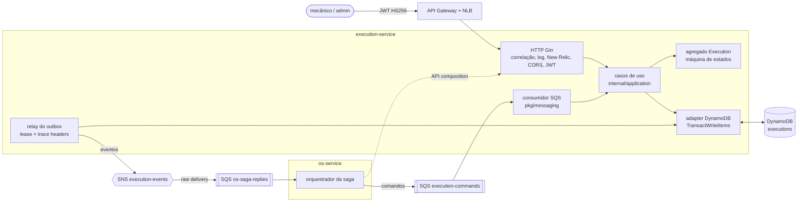
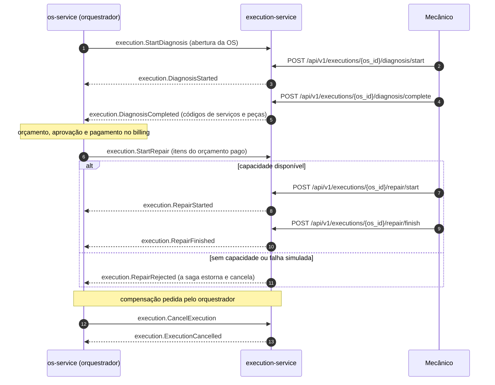
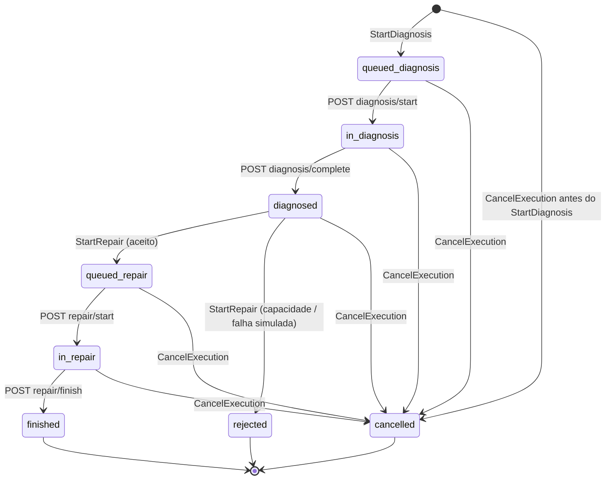

# postech-tc4-execution-service

Microsserviço de **execução e produção** da oficina mecânica: mantém a fila de trabalho do mecânico, recebe da saga as ordens de serviço (OS) a diagnosticar e a reparar, expõe a API com que o mecânico avança cada etapa e publica o progresso de volta para a saga. Participa da **saga orquestrada** pelo [os-service](https://github.com/Kc1t/postech-tc4-os-service): recebe comandos na fila `execution-commands` e responde com eventos no tópico `execution-events`.

Tech Challenge Fase 4, FIAP Pós Tech SOAT. Go 1.26, Gin, DynamoDB (tabela única), SNS/SQS, New Relic, logs JSON (`log/slog`), Terraform e GitHub Actions.

| Repositório | Papel | Banco |
|---|---|---|
| [postech-tc4-os-service](https://github.com/Kc1t/postech-tc4-os-service) | OS, clientes, veículos, catálogo e estoque; orquestrador da saga | PostgreSQL (RDS) |
| [postech-tc4-billing-service](https://github.com/Kc1t/postech-tc4-billing-service) | orçamento e pagamento com Mercado Pago | PostgreSQL (RDS) |
| **postech-tc4-execution-service** (este) | fila de diagnóstico e reparo da oficina | DynamoDB |
| [postech-tc4-notification-lambda](https://github.com/Kc1t/postech-tc4-notification-lambda) | e-mail ao cliente a cada mudança de status da OS | DynamoDB (deduplicação) |
| [postech-tc4-lambda-auth](https://github.com/Kc1t/postech-tc4-lambda-auth) | CPF → JWT e authorizer do API Gateway | (consulta o os-service) |
| [postech-tc4-infra-k8s](https://github.com/Kc1t/postech-tc4-infra-k8s) | EKS, API Gateway, SNS/SQS/DLQ, observabilidade, e2e local | — |

## Guia rápido para avaliação

| Entregável da fase 4 | Onde está |
|---|---|
| Código-fonte | `cmd/`, `internal/`, `pkg/` ([Arquitetura](#arquitetura)) |
| Dockerfile e manifestos Kubernetes | [`Dockerfile`](Dockerfile) e [`k8s/`](k8s/README.md) ([CI/CD e deploy](#cicd-e-deploy)) |
| Banco próprio | tabela DynamoDB `executions`, criada por [`infra/`](infra/) ([Banco e modelo de dados](#banco-e-modelo-de-dados)) |
| Pipeline de CI/CD | [`.github/workflows/ci.yml`](.github/workflows/ci.yml) |
| Evidência de cobertura | **95,6%** no `go test` e **95,3%** no SonarQube, publicados no resumo de cada [execução do CI](https://github.com/Kc1t/postech-tc4-execution-service/actions/workflows/ci.yml) ([Testes](#testes-e-evidência-de-cobertura)) |
| Documentação da arquitetura do serviço | este README, de [Responsabilidades](#responsabilidades) a [Decisões e limitações](#decisões-e-limitações) |
| Swagger e Postman | [`docs/swagger.yaml`](docs/swagger.yaml), servido em `/swagger/index.html`, e [`postman_collection.json`](postman_collection.json) ([Swagger e Postman](#swagger-e-postman)) |

## Responsabilidades

| Faz | Não faz |
|---|---|
| Mantém o estado da execução de cada OS (`queued_diagnosis` → `in_diagnosis` → `diagnosed` → `queued_repair` → `in_repair` → `finished`) com a linha do tempo de quem fez o quê e quando | Precificar serviços e peças ou reservar estoque (é do os-service) |
| Serve a fila de trabalho priorizada: reparos (orçamento já pago) antes de diagnósticos e, em cada raia, as mais antigas primeiro | Orçamento e pagamento (é do billing-service) |
| Consome os comandos da saga (`StartDiagnosis`, `StartRepair`, `CancelExecution`) de forma idempotente | Decidir a ordem das etapas e as compensações (é do orquestrador) |
| Recusa o reparo quando a oficina está sem capacidade (`MAX_CONCURRENT_REPAIRS`) ou quando a falha é simulada, publicando `RepairRejected` para a saga compensar | Notificar o cliente (é da notification-lambda) |
| Publica os eventos de progresso sempre pelo outbox, na mesma transação da mudança de estado | Acessar o banco de outro serviço |
| Responde a API composition do os-service (`GET /api/v1/executions/{os_id}`) | |

O diagnóstico informa só os **códigos** de serviços e peças; quem precifica é o os-service.

## Arquitetura



Arquitetura hexagonal, no mesmo desenho do os-service:

| Pasta | Conteúdo |
|---|---|
| `cmd/api` | `main.go`, `bootstrap` (injeção de dependências, `Run` com desligamento gracioso), `routes` e `middleware` |
| `internal/domain` | agregado `Execution`, status e prioridades, linha do tempo e erros sentinela |
| `internal/ports` | interfaces de repositório e casos de uso, com `mocks` gerados pelo `mockgen` (`make mocks`) |
| `internal/application/usecase/execution` | um arquivo por operação (comandos da saga e ações do mecânico) |
| `internal/adapters/inbound/http` | handlers, DTOs, health e erro padronizado |
| `internal/adapters/inbound/messaging/commands` | registro dos handlers de comando no consumidor |
| `internal/adapters/outbound/dynamodb` | repositório, relay do outbox e esquema da tabela |
| `pkg/` | chassis copiado do os-service: `contracts`, `messaging`, `httpclient`, `awsx`, `logger`, `observability`, `env` |
| `infra/` | Terraform da tabela DynamoDB |
| `test/component` | teste de componente (build tag `component`) |

### O execution na saga

A saga é orquestrada pelo os-service ([ADR-0017](https://github.com/Kc1t/postech-tc4-os-service/blob/main/docs/adr/0017-saga-orquestrada-no-os-service.md)). O execution não conhece o billing nem a ordem das etapas: recebe um comando, muda o estado e publica o evento.



### Máquina de estados



Transição fora do fluxo devolve `409 INVALID_TRANSITION` na API. Nos comandos da saga, regra de negócio violada nunca vira erro (que mandaria a mensagem para retry e DLQ): vira evento de falha ou é ignorada com log.

## Comunicação

| Canal | Direção | Nome |
|---|---|---|
| HTTP síncrono | entrada | API Gateway → NLB `execution-service-public` (painel do mecânico); `Service execution-service` (ClusterIP) para a API composition do os-service |
| SQS | consome | fila `execution-commands` (DLQ `execution-commands-dlq` depois de 5 recebimentos) |
| SNS | publica | tópico `execution-events`, assinado pela fila `os-saga-replies` com raw delivery |

### API HTTP

Todas as rotas de `/api/v1` exigem `Authorization: Bearer <JWT>` com `role` `admin` ou `mechanic` (detalhes em [Segurança](#segurança)).

| Método e rota | Efeito | Evento publicado |
|---|---|---|
| `GET /health/live` | processo de pé (liveness) | — |
| `GET /health/ready` | DynamoDB acessível (`DescribeTable`); `503` quando não | — |
| `GET /api/v1/executions/queue?status=&limit=` | fila de trabalho. Sem `status`: `queued_repair` e depois `queued_diagnosis`, mais antigas primeiro. Com `status` (ativo): só aquela raia. `limit` de 1 a 200, padrão 50 | — |
| `GET /api/v1/executions/{os_id}` | estado atual e linha do tempo (também usado pela API composition do os-service) | — |
| `POST /api/v1/executions/{os_id}/diagnosis/start` | `queued_diagnosis` → `in_diagnosis` | `DiagnosisStarted` |
| `POST /api/v1/executions/{os_id}/diagnosis/complete` | `in_diagnosis` → `diagnosed`. Corpo `{"services":[{"code":12}],"parts":[{"manufacturer_code":"MONROE-G16","quantity":2}],"notes":"..."}`, com ao menos um serviço ou peça | `DiagnosisCompleted` |
| `POST /api/v1/executions/{os_id}/repair/start` | `queued_repair` → `in_repair` | `RepairStarted` |
| `POST /api/v1/executions/{os_id}/repair/finish` | `in_repair` → `finished` | `RepairFinished` |
| `GET /swagger/index.html` | Swagger UI | — |

O `X-Correlation-ID` da requisição (gerado se ausente e devolvido na resposta) vai para os logs e para o `correlation_id` do evento publicado. O `sub` do JWT fica registrado como autor na linha do tempo.

#### Erros

Toda resposta de erro tem o formato `{"error":{"code":"...","message":"..."}}`.

| HTTP | `code` | Quando |
|---|---|---|
| 400 | `VALIDATION_ERROR` | corpo ou parâmetro inválido (`os_id` vazio, `limit` não numérico, JSON malformado) |
| 400 | `INVALID_STATUS` | `status` desconhecido ou final na fila |
| 401 | `UNAUTHORIZED` | token ausente, inválido, expirado, sem `exp`, sem `sub` ou `role`, ou com algoritmo diferente de HS256 |
| 403 | `FORBIDDEN` | papel sem acesso (cliente) |
| 403 | `ORIGIN_NOT_ALLOWED` | preflight CORS de origem fora da allowlist |
| 404 | `EXECUTION_NOT_FOUND` | não existe execução para o `os_id` |
| 404 | `NOT_FOUND` | rota inexistente |
| 405 | `METHOD_NOT_ALLOWED` | método não suportado na rota |
| 409 | `INVALID_TRANSITION` | ação incompatível com o status atual |
| 409 | `CONCURRENT_UPDATE` | outra atualização da mesma execução venceu (lock otimista); repita |
| 422 | `INVALID_DIAGNOSIS` | diagnóstico sem serviços nem peças, ou com código ou quantidade inválidos |
| 503 | `SERVICE_UNAVAILABLE` | readiness: DynamoDB inacessível |
| 500 | `INTERNAL_ERROR` | erro inesperado (detalhe só no log) |

### Swagger e Postman

- **Swagger**: [`docs/swagger.yaml`](docs/swagger.yaml) e [`docs/swagger.json`](docs/swagger.json), gerados das anotações dos handlers com `make swagger`. O serviço publica a UI em `/swagger/index.html` (`http://localhost:8083/swagger/index.html` no compose). O job `quality` do CI falha se o Swagger estiver desatualizado em relação ao código.
- **Postman**: [`postman_collection.json`](postman_collection.json) tem teste em toda requisição (72 requisições, 172 asserções) e roda sozinha. A pasta 0 faz login no os-service, cria cliente, veículo e catálogo e abre as cinco OS da saga; a pasta 3 faz no billing a decisão do cliente e o pagamento simulado. O resto é deste serviço:
  - acesso: sem token → 401, JWT de cliente → 403;
  - fila do mecânico: status final ou desconhecido → 400, `limit` inválido → 400;
  - diagnóstico: transição fora de ordem → 409, diagnóstico vazio → 422, `os_id` que não é UUID → 400, inexistente → 404;
  - reparo e estado final das execuções compensadas (`rejected` e `cancelled`).

  As esperas da saga são polling na própria requisição. Com a stack de [`postech-tc4-infra-k8s/local`](https://github.com/Kc1t/postech-tc4-infra-k8s/tree/main/local) no ar (`make up && make lambdas && make gateway`), rode no Collection Runner; `make postman` lá roda as três collections encadeadas. `make seed` e `make token` continuam úteis para testar este serviço sem o os-service.

### Mensagens consumidas (fila `execution-commands`)

Os envelopes seguem `pkg/contracts` (`message_id`, `type`, `version`, `saga_id`, `os_id`, `correlation_id`, `causation_id`, `producer`, `occurred_at`, `payload`), com JSON Schema por tipo em `pkg/contracts/schemas`, idêntico nos quatro repositórios Go e documentado no [AsyncAPI do os-service](https://github.com/Kc1t/postech-tc4-os-service/blob/main/docs/asyncapi/asyncapi.yaml).

| Comando | Payload | Efeito | Eventos |
|---|---|---|---|
| `execution.StartDiagnosis` | `os_code`, `vehicle`, `notes` | Cria a execução em `queued_diagnosis`. Idempotente por `os_id`: se já existe, ignora (`command_ignored`). | nenhum; o próximo evento sai quando o mecânico age |
| `execution.StartRepair` | `os_code`, `items[]`, `simulate_failure` | `diagnosed` → `queued_repair` com os itens. Capacidade esgotada ou `simulate_failure=repair` (com `FAULT_INJECTION_ENABLED=true`) → `rejected`. OS inexistente ou fora de `diagnosed` → `RepairRejected` sem mudar o estado. Reparo já aceito → ignora. | `RepairRejected{reason}` quando recusa |
| `execution.CancelExecution` | `reason` | Status não final → `cancelled`. Status final → ignora. OS ainda inexistente → grava a execução já cancelada (o SQS não garante ordem, e um `StartDiagnosis` atrasado não a reabre). | `ExecutionCancelled{reason}` |

Motivos do `RepairRejected`: `capacidade de reparos esgotada (N de M em andamento)`, `falha simulada: reparo recusado (simulate_failure=repair)`, `execução não encontrada para a OS` e `execução em <status> não pode iniciar reparo`.

### Mensagens publicadas (tópico `execution-events`)

| Evento | Payload | Quando |
|---|---|---|
| `execution.DiagnosisStarted` | `started_at` | mecânico iniciou o diagnóstico |
| `execution.DiagnosisCompleted` | `services[{code}]`, `parts[{manufacturer_code, quantity}]`, `notes` | diagnóstico concluído (o os-service monta o orçamento) |
| `execution.RepairStarted` | `started_at` | mecânico iniciou o reparo |
| `execution.RepairFinished` | `finished_at` | reparo concluído |
| `execution.RepairRejected` | `reason` | reparo recusado (a saga estorna e cancela) |
| `execution.ExecutionCancelled` | `reason` | compensação aplicada |

Os eventos de resposta carregam `saga_id`, `os_id` e `correlation_id` do comando e, no `causation_id`, o `message_id` do comando que os causou. Os atributos SNS (`message_type`, `message_id`, `saga_id`, `os_id` e os headers de trace) chegam à fila `os-saga-replies` pelo raw delivery.

### Garantias de entrega

- **Inbox**: cada comando processado grava `MSG#execution-commands#{message_id}` com `attribute_not_exists` na mesma transação da mudança. Reentrega do mesmo `message_id` é descartada (`message_duplicate`), pela pré-checagem e pela condição da transação. Reenvio do orquestrador com outro `message_id` também é seguro, porque cada caso de uso olha o status atual antes de agir.
- **Outbox**: o evento é gravado como item `OUTBOX` na transação do estado. O relay consulta os pendentes a cada `OUTBOX_POLL_INTERVAL`, reserva cada item com um `UpdateItem` condicional (lease de 30 s, o equivalente ao `FOR UPDATE SKIP LOCKED` do `pkg/outbox`), publica com `messaging.AWSPublisher` e marca como publicado (TTL de 24 h). Falha de publicação incrementa `attempts` e troca o lease pela hora da próxima tentativa, com espera exponencial (1 s, 2 s, 4 s... até 5 min): a mensagem que não publica não ocupa o lote das outras. A partir da 10ª tentativa cada falha vira `outbox_message_stuck`. Várias réplicas podem rodar o relay ao mesmo tempo. A entrega é *at-least-once*, e o inbox do consumidor do outro lado deduplica.
- **Erro só para falha transitória**: DynamoDB indisponível devolve erro e a mensagem volta para a fila até ir para a DLQ (`maxReceiveCount` 5). Conflito de versão é relido e tentado de novo até 3 vezes (`command_conflict_retry`). Payload fora do contrato gera `message_malformed` e termina na DLQ para análise.
- **Trace distribuído**: o item de outbox guarda os headers W3C/New Relic da transação que o gravou. O relay abre a transação `OutboxRelay/{tipo}` aceitando esses headers, então HTTP → DynamoDB → SNS → os-service aparece como um trace só.

## Banco e modelo de dados

Tabela DynamoDB única `executions`, criada pelo Terraform em [`infra/`](infra/): `PAY_PER_REQUEST`, chaves `pk`/`sk`, GSI `gsi1` (`gsi1pk`/`gsi1sk`, projeção ALL), TTL no atributo `ttl`, point-in-time recovery e criptografia em repouso ligados, sem deletion protection (ambiente acadêmico). Nenhum outro serviço lê esta tabela: o os-service consulta a execução pela API ([ADR-0012](https://github.com/Kc1t/postech-tc4-os-service/blob/main/docs/adr/0012-banco-por-servico.md)).

| Item | `pk` | `sk` | `gsi1pk` | `gsi1sk` | Atributos principais |
|---|---|---|---|---|---|
| Execução (estado atual) | `EXEC#{os_id}` | `STATE` | `QUEUE#{status}` (só status ativos) | `{prioridade}#{enfileirada_em}` | status, prioridade, veículo, diagnóstico, itens, motivo, timestamps de cada etapa, `version` |
| Linha do tempo | `EXEC#{os_id}` | `EVT#{ts}#{id}` | — | — | tipo, de → para, autor (id e tipo), detalhes |
| Outbox | `OUTBOX` | `{ts}#{message_id}` | — | — | destino, envelope, trace headers, `published`, `lease_until`, `attempts`, `last_error`, `ttl` |
| Inbox | `MSG#{consumer}#{message_id}` | `MSG` | — | — | tipo, processado em, `ttl` (15 dias) |

Os timestamps das chaves têm largura fixa (nanossegundos com 9 dígitos), então a ordem lexicográfica é a cronológica.

### Padrões de acesso

| Necessidade | Operação |
|---|---|
| Estado de uma OS (comandos e ações) | `GetItem` `EXEC#{os_id}`/`STATE` com leitura consistente |
| Detalhe com linha do tempo | uma `Query` em `pk = EXEC#{os_id}` (STATE e EVT# juntos) |
| Fila de uma raia, mais antigas primeiro | `Query` no `gsi1` com `gsi1pk = QUEUE#{status}` (ordem do `gsi1sk`) |
| Fila padrão (reparo antes de diagnóstico) | duas `Query` no `gsi1` (`queued_repair`, depois `queued_diagnosis`) |
| Capacidade de reparos | `Query` com `Select=COUNT` em `QUEUE#queued_repair` e `QUEUE#in_repair` |
| Mudança de estado | uma `TransactWriteItems`: STATE (`#v = :expected`, ou `attribute_not_exists` ao criar), EVT#, OUTBOX e inbox (`attribute_not_exists`), com `ClientRequestToken` |
| Mensagem já processada? | `GetItem` no item de inbox |
| Pendentes do outbox | `Query` em `pk = OUTBOX` com filtro `published = false` e lease livre |

O `gsi1` é **esparso**: quando a execução chega a um status final, o item deixa de ter `gsi1pk` e sai do índice sozinho, então a fila só contém trabalho em andamento. Conflito de versão vira `ErrConcurrentUpdate` (`409 CONCURRENT_UPDATE` na API; nos comandos, o caso de uso relê e tenta de novo).

### Por que DynamoDB

- O acesso é sempre por chave conhecida (`os_id`) ou por uma fila ordenada por status: cabe em chave primária e um GSI, sem joins nem consultas ad hoc.
- Cada OS é um agregado independente, sem transação entre OS. A `TransactWriteItems` dá a atomicidade de que o outbox e o inbox precisam (estado, linha do tempo, outbox e inbox, tudo ou nada), e a `ConditionExpression` na `version` dá o lock otimista.
- Serverless e `PAY_PER_REQUEST`: nada a administrar no Learner Lab, escala com o volume da oficina, e o TTL nativo limpa o inbox e o outbox publicado.
- Banco de tipo diferente do Postgres dos outros serviços, reforçando *database per service*: a integração é só por eventos e pela API.

### Alternativas descartadas

- **MongoDB / Amazon DocumentDB**: o documento por OS seria natural, mas o DocumentDB exige cluster provisionado dentro da VPC (custo fixo e mais infraestrutura no Learner Lab) e não traz nada que os padrões de acesso acima precisem; Mongo autogerenciado no EKS adicionaria backup e operação de estado no cluster.
- **Redis (ElastiCache)**: bom para a fila (sorted set), mas é armazenamento em memória, sem a durabilidade e a transação condicional necessárias para ser a fonte da verdade do estado e do outbox.
- **PostgreSQL (RDS)**: atenderia, mas é o que os outros serviços já usam; a fase pede bancos de tipos diferentes, e o modelo da execução não tem relações que justifiquem SQL.

## Segurança

- **JWT revalidado no serviço**: o API Gateway já passou a requisição pelo Lambda authorizer, e o serviço valida o token de novo (`cmd/api/middleware/auth.go`): só HS256, `exp` obrigatório, `sub` e `role` preenchidos. Falhou, 401. O segredo (`JWT_SECRET`) é o mesmo do os-service e da lambda-auth.
- **Papel por rota**: toda a API de `/api/v1` é da equipe da oficina (`admin` e `mechanic`). O token de cliente, ou de qualquer outro papel, recebe **403 `FORBIDDEN`**. O login da equipe no os-service emite tokens `admin`; o `make token` gera um token `mechanic` para desenvolvimento. Como nenhuma rota é do cliente, não há regra de dono do recurso aqui: o cliente acompanha a OS pelo os-service e pelos e-mails da notification-lambda.
- **Chamada entre serviços**: a API composition do os-service (`GET /service-orders/{id}/details`, rota da equipe) chama este serviço pelo ClusterIP com um JWT de serviço de 2 minutos (`sub` `service:os-service`, papel `admin`), assinado com o mesmo segredo.
- **Autoria**: o `sub` do token fica gravado como autor em cada evento da linha do tempo.
- **CORS** só para as origens de `CORS_ALLOWED_ORIGINS`; `*` sozinho libera todas (a resposta devolve a própria origem) e curinga parcial (`https://*.x.com`) é recusado na subida. Em `APP_ENV=prod`, o `JWT_SECRET` padrão também é recusado.
- **Execução**: container sem root (UID 10001), sistema de arquivos só leitura e sem capabilities; `NetworkPolicy` com entrada só na porta 8080; segredos no `Secret` do Kubernetes criado pelo CI a partir dos GitHub Secrets; credenciais AWS pelo role do nó (LabRole, [ADR-0016](https://github.com/Kc1t/postech-tc4-os-service/blob/main/docs/adr/0016-credenciais-dos-pods-pela-labrole.md)).
- **Injeção de falha** (`simulate_failure=repair`) só com `FAULT_INJECTION_ENABLED=true`; a subida registra `fault_injection_enabled` quando ela está ligada.

## Observabilidade

New Relic (agente Go) e logs JSON no stdout, coletados no cluster pelo `nri-bundle`. Dashboard, alertas e SLOs ficam em Terraform no [postech-tc4-infra-k8s/observability](https://github.com/Kc1t/postech-tc4-infra-k8s/tree/main/observability).

- **APM**: `appName` `execution-service-postech` (`NEW_RELIC_APP_NAME` do ConfigMap). Transação web por rota (`nrgin`, com atributos `correlation_id` e `os_id`), transação `Consume/<tipo>` por mensagem consumida (atributos `messaging.consumer`, `message_type`, `message_id`, `saga_id`, `os_id`, `receive_count`) e `OutboxRelay/<tipo>` por mensagem publicada. Segmentos de DynamoDB, SQS e SNS pelo `nrawssdk-v2`. Erros de consumo e de publicação são marcados com `NoticeError`.
- **Trace distribuído**: começa na requisição do mecânico ou no comando consumido, passa pelo item de outbox e continua no os-service pelos atributos da mensagem SNS.
- **Logs**: o texto vai na chave `message`; toda linha tem `service`, e as de requisição e mensageria têm `correlation_id`, `trace.id` e `span.id` (logs em contexto). Requisições geram a linha `request` (`method`, `path`, `route`, `status`, `latency_ms`, `user_id`, `user_role`), sem as probes de health. Mensagens trazem `saga_id`, `os_id`, `message_id`, `message_type` e `consumer`.

| Logs de negócio e de falha | Significado |
|---|---|
| `execution_status_changed` (`from`, `to`, autor) | toda mudança de status |
| `repair_rejected` (`reason`) | reparo recusado por capacidade, falha simulada ou estado |
| `command_ignored` (`reason`) | comando sem efeito (execução já existe, reparo já aceito, execução encerrada) |
| `command_conflict_retry`, `message_duplicate` | lock otimista e inbox |
| `message_failed` (`receive_count`), `message_malformed` | consumo de `execution-commands` |
| `outbox_publish_failed`, `outbox_message_stuck`, `outbox_final_flush` | publicação no SNS e flush no desligamento |
| `panic_recovered` | panic numa requisição, respondido com 500 |

Alertas que cobrem o serviço (cada um com runbook em [`docs/runbooks`](https://github.com/Kc1t/postech-tc4-infra-k8s/tree/main/docs/runbooks) do infra-k8s):

| Alerta | Condição |
|---|---|
| `execution-service: taxa de erro acima de 5% em 5 min` | respostas 5xx sobre as requisições de negócio |
| `execution-service: latência p95 acima de 1 s em 5 min` | p95 das requisições de negócio |
| `mensageria: mensagem falhou na última entrega antes da DLQ (receive_count >= 5)` | `message_failed` do consumidor `execution-commands` na 5ª entrega; o alarme `postech-tc4-prod-dlq-execution-commands` do CloudWatch confirma a DLQ |
| `mensageria: mensagem malformada recebida em 5 min` | `message_malformed` |
| `mensageria: mensagem travada no outbox` | `outbox_message_stuck` |
| SLO `execution-service: disponibilidade (sem 5xx)` | 99,5% em 7 dias |

## Configuração

| Variável | Padrão | Descrição |
|---|---|---|
| `APP_PORT` | `8080` | porta HTTP |
| `APP_ENV` | `development` | `development` ou `prod` (em `prod` o `JWT_SECRET` padrão é recusado e o Gin roda em release) |
| `LOG_LEVEL` | `info` | `debug`, `info`, `warn`, `error` |
| `NEW_RELIC_APP_NAME` | `execution-service` | nome da aplicação no New Relic (`execution-service-postech` no EKS) |
| `NEW_RELIC_LICENSE_KEY` | — | sem chave, o agente fica desligado e o serviço funciona |
| `JWT_SECRET` | `change-me-in-production` | segredo HS256 compartilhado com o os-service e a lambda-auth |
| `CORS_ALLOWED_ORIGINS` | `http://localhost:3000` | allowlist separada por vírgula (`*` libera todas) |
| `AWS_REGION` | `us-east-1` | região |
| `AWS_ENDPOINT_URL` | — | endpoint do LocalStack em desenvolvimento; vazio na AWS |
| `DYNAMODB_TABLE` | `executions` | tabela única |
| `SQS_EXECUTION_COMMANDS_URL` | — (obrigatória) | fila de comandos |
| `SNS_EXECUTION_EVENTS_ARN` | — (obrigatória) | tópico de eventos |
| `MAX_CONCURRENT_REPAIRS` | `10` | máximo de execuções em `queued_repair` + `in_repair` |
| `FAULT_INJECTION_ENABLED` | `false` | habilita `simulate_failure=repair` nos comandos |
| `OUTBOX_POLL_INTERVAL` | `500ms` | intervalo do relay do outbox |
| `SHUTDOWN_TIMEOUT` | `20s` | tempo máximo do desligamento gracioso |

As credenciais AWS seguem a cadeia padrão do SDK (no EKS, o role do nó). O [`.env.example`](.env.example) aponta para o LocalStack do compose.

## Como rodar localmente

Pré-requisitos: Docker; para rodar fora do container, Go 1.26 e, se for gerar código, `swag`, `mockgen` e `golangci-lint`.

```bash
cp .env.example .env            # opcional; o compose já define o necessário
make up                         # execution-service em http://localhost:8083 + LocalStack em :4568
make seed                       # enfileira 3 OS de exemplo (StartDiagnosis na fila)
make token                      # JWT de mecânico (ROLE=admin make token para administrador)
make smoke                      # fluxo completo: comandos → API do mecânico → eventos publicados
make down
```

O LocalStack sobe com `deploy/localstack/init-aws.sh` (a mesma topologia de filas, tópicos e tabela do Terraform) e `deploy/localstack/enable-ttl.sh` (liga o TTL da tabela). Para rodar o binário no host contra esse LocalStack: `make localstack && go run ./cmd/api`, com o `.env` do `.env.example`. As portas do host podem ser trocadas com `EXECUTION_SERVICE_PORT` (8083) e `LOCALSTACK_PORT` (4568).

Fora do LocalStack, `scripts/create-table.sh` cria a tabela com o mesmo esquema e liga o TTL (`ENDPOINT_URL=http://localhost:4568` aponta para o LocalStack).

O `make smoke` faz o papel do os-service: publica os comandos na fila `execution-commands`, chama a API como mecânico e lê os eventos na fila `os-saga-replies`. O fluxo completo com os três serviços, as Lambdas no LocalStack e o Mailpit roda no ambiente e2e do [postech-tc4-infra-k8s/local](https://github.com/Kc1t/postech-tc4-infra-k8s/tree/main/local) (`make all`).

## Testes e evidência de cobertura

| Comando | O que roda |
|---|---|
| `make test-unit` | testes de unidade (domínio, casos de uso com gomock, handlers com `httptest`, consumidor, middlewares, chassis); os testes de DynamoDB são pulados sem `AWS_ENDPOINT_URL` |
| `make localstack` | sobe só o LocalStack (porta 4568) |
| `make test` | unidade e integração do repositório e do relay contra o DynamoDB do LocalStack (cada teste cria e apaga a própria tabela) |
| `make test-integration` | só os testes do adapter DynamoDB |
| `make test-component` | teste de componente com LocalStack |
| `make cover` | cobertura com LocalStack, sem `cmd/`, `docs/`, `mocks/`, `scripts/` e `test/` |
| `make lint` | golangci-lint (`.golangci.yml`) |

Para usar outro LocalStack: `LOCALSTACK_URL=http://localhost:4566 make test`.

- **Unidade**: máquina de estados e prioridades, casos de uso com gomock (inclusive capacidade esgotada, falha simulada com e sem a flag e conflito de versão), espera exponencial do outbox, handlers, middlewares (JWT, papel, CORS e correlação) e configuração.
- **Integração**: repositório e relay do outbox contra o DynamoDB do LocalStack: publicação em ordem, falha que registra a tentativa sem travar o lote, reserva entre réplicas e corpo inválido.
- **Contrato**: todo evento que os casos de uso gravam no outbox passa no JSON Schema do seu tipo (`internal/application/usecase/execution/contract_test.go`), e o exemplo do schema de cada comando de `execution-commands` é aceito pelo handler registrado (`internal/adapters/inbound/messaging/commands/contract_test.go`).
- **Componente** (`test/component`): sobe o serviço inteiro em processo (o mesmo `bootstrap` do `main`) com tabela, fila, tópico e uma fila observadora próprios no LocalStack, e verifica comando → efeito → evento: caminho feliz, mensagem duplicada sem novo evento, 409 padronizado, reparo recusado por falha simulada e cancelamento, inclusive antes do `StartDiagnosis`.
- **BDD**: o fluxo completo da saga em Gherkin (godog) fica no os-service, que orquestra a saga ([`features/saga.feature`](https://github.com/Kc1t/postech-tc4-os-service/blob/main/features/saga.feature)); o lado do execution é coberto pelo teste de componente e pelo e2e do infra-k8s.

Cobertura por pacote (`make cover` com LocalStack, mesma medição do CI):

| Pacote | Cobertura |
|---|---|
| domínio (`internal/domain/entities`) | 99,0% |
| casos de uso | 96,2% |
| adapter DynamoDB | 94,5% (75,1% sem LocalStack, só com os testes de unidade do mapeamento de erros) |
| handlers HTTP, consumidor e `config` | 100% |
| chassis `pkg/` | `contracts` 93,5%, `httpclient` 94,9%, `messaging` 94,2%, `awsx` e `logger` 80%, `env` e `observability` 100% |

**Evidência de cobertura:** **95,6%** no `go test` (`make cover`) e **95,3%** no SonarQube, com o quality gate aprovado (0 bugs, 0 vulnerabilidades, 0 code smells, 0% de duplicação). Cada execução do [CI](https://github.com/Kc1t/postech-tc4-execution-service/actions/workflows/ci.yml) publica no resumo do job a cobertura (job `tests`) e a tabela do SonarQube (job `sonarqube`); o pipeline reprova abaixo de 80%.

## CI/CD e deploy

Pipeline próprio em [`.github/workflows/ci.yml`](.github/workflows/ci.yml), independente dos outros serviços, em PR e push para `main` e `homolog`.

| Job | O que faz |
|---|---|
| `quality` | `go mod tidy` sem diff, gofmt, `go vet` (também com a tag `component`), golangci-lint, gosec (falha a partir de severidade média), govulncheck e Swagger em dia com o código |
| `tests` | LocalStack de teste, `make cover` e cobertura mínima de 80% |
| `component` | teste de componente com LocalStack (`make test-component`) |
| `sonarqube` | SonarQube Community num container do job, com quality gate próprio: cobertura ≥ 80%, duplicação ≤ 3% e nota A em confiabilidade, segurança e manutenibilidade |
| `terraform` | fmt, validate e tfsec do `infra/` |
| `image` | build da imagem e Trivy (CRITICAL com correção bloqueia) |
| `deploy` | só em push na `main`, depois de todos os anteriores e com `AWS_DEPLOY_ENABLED=true` |

A `main` é protegida: só recebe PR, com a branch atualizada, conversas resolvidas e os checks `quality`, `tests`, `component`, `sonarqube`, `terraform` e `image` obrigatórios, inclusive para administradores. O deploy depende da variável `AWS_DEPLOY_ENABLED=true` porque as credenciais do Learner Lab expiram a cada sessão.

O job `deploy`:

1. `terraform apply` do `infra/` (tabela `executions`), com state em `execution-service/prod.tfstate`;
2. build e push da imagem no ECR (`execution-service:<sha>`);
3. cria o `Secret` `execution-service-secret` (`JWT_SECRET`, `NEW_RELIC_LICENSE_KEY`);
4. troca os `*_PLACEHOLDER` dos manifests (imagem, namespace, região, conta, CORS e `FAULT_INJECTION_ENABLED`) e falha se sobrar algum;
5. `kubectl apply` no namespace `postech`, `rollout status` e smoke test em `/health/ready` pelo NLB.

Depois do primeiro deploy, o workflow do [postech-tc4-infra-k8s](https://github.com/Kc1t/postech-tc4-infra-k8s) liga as rotas `/api/v1/executions` do API Gateway ao NLB `execution-service-public`.

### Imagem e manifestos Kubernetes

[`Dockerfile`](Dockerfile) multi-stage: binário estático compilado em `golang:1.26-alpine` e executado em `alpine:3.22` com o usuário 10001 e `HEALTHCHECK` em `/health/live`. Manifestos em [`k8s/`](k8s/README.md): Deployment com 2 réplicas, `RollingUpdate` `maxSurge: 1`/`maxUnavailable: 0`, probes separadas, `runAsNonRoot` e `readOnlyRootFilesystem`; Service ClusterIP (API composition) e NLB (API Gateway); HPA de 2 a 6 réplicas, PDB e NetworkPolicy.

No `SIGTERM`, o serviço para de aceitar HTTP, conclui as requisições em andamento, para o consumidor e o relay e faz um último flush do outbox (`outbox_final_flush`).

## Decisões e limitações

- **Capacidade de reparos é eventualmente consistente**: o `COUNT` no GSI não é transacional com o aceite, então dois `StartRepair` simultâneos podem passar do limite por um. Resolver exigiria um item contador com `UpdateItem` condicional na mesma transação.
- **Partição única do outbox** (`pk = OUTBOX`): suficiente para o volume de uma oficina; em escala maior, particionar por `OUTBOX#{shard}`.
- **Sem ordem global entre OS**: o relay entrega *at-least-once*, e a saga trata duplicatas pelo inbox. Dentro de uma OS, o `CancelExecution` que chega antes do `StartDiagnosis` já é tratado.
- **TTL obrigatório na tabela**: ligado pelo Terraform, por `scripts/create-table.sh` ou por `enable-ttl.sh` no LocalStack; sem ele, o inbox e o outbox publicado só crescem.
- **Rotas no infra-k8s**: a rota do API Gateway para `/api/v1/executions/*` (NLB `execution-service-public`) é configurada no repositório de infraestrutura.
