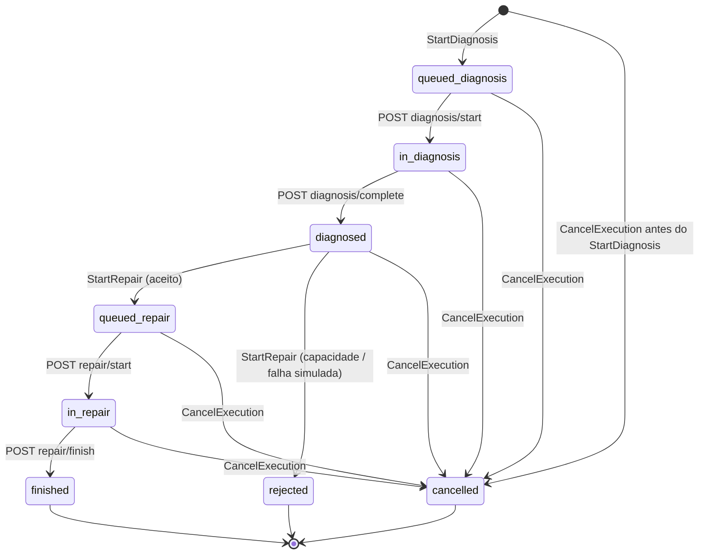

# execution-service — Execução e Produção

Microsserviço da oficina mecânica (Tech Challenge FIAP SOAT, fase 4) responsável pela **fila de trabalho do mecânico**: recebe da saga do os-service as ordens de serviço a diagnosticar e a reparar, expõe a API que o mecânico usa para avançar cada etapa e publica os eventos de progresso de volta para a saga.

Go 1.26 · Gin · DynamoDB (tabela única) · SQS/SNS · New Relic · arquitetura hexagonal.

## Responsabilidades

- Manter o estado da execução de cada OS (`queued_diagnosis` → `in_diagnosis` → `diagnosed` → `queued_repair` → `in_repair` → `finished`) com a linha do tempo de quem fez o quê e quando.
- Servir a fila de trabalho priorizada: reparos (orçamento já pago) antes de diagnósticos e, em cada raia, as mais antigas primeiro.
- Consumir os comandos da saga (`StartDiagnosis`, `StartRepair`, `CancelExecution`) de forma idempotente.
- Recusar o reparo quando a oficina está sem capacidade (`MAX_CONCURRENT_REPAIRS`) ou quando a falha é simulada, publicando `RepairRejected` para a saga compensar.
- Publicar os eventos (`DiagnosisStarted`, `DiagnosisCompleted`, `RepairStarted`, `RepairFinished`, `RepairRejected`, `ExecutionCancelled`) **sempre via outbox**, na mesma transação da mudança de estado.
- Responder a API composition do os-service (`GET /api/v1/executions/{os_id}`).

Fora do escopo: catálogo, estoque, orçamento e pagamento (os-service e billing-service). O diagnóstico informa só os **códigos** de serviços e peças; quem precifica é o os-service.

## Arquitetura


Camadas (iguais às do os-service):

| Pasta | Conteúdo |
|---|---|
| `cmd/api` | `main.go`, `bootstrap` (injeção de dependências, `Run` com graceful shutdown), `routes`, `middleware` |
| `internal/domain` | agregado `Execution`, status e prioridades, linha do tempo, erros sentinela |
| `internal/ports` | interfaces de repositório e casos de uso + `mocks` (mockgen) |
| `internal/application/usecase/execution` | um arquivo por operação (comandos da saga e ações do mecânico) |
| `internal/adapters/inbound/http` | handlers, DTOs, health e erro padronizado |
| `internal/adapters/inbound/messaging/commands` | registro dos handlers de comando no consumidor |
| `internal/adapters/outbound/dynamodb` | repositório, relay do outbox e esquema da tabela |
| `pkg/` | chassis copiado do os-service (`contracts`, `messaging`, `httpclient`, `awsx`, `logger`, `observability`, `env`) |
| `test/component` | teste de componente (build tag `component`) |

### Máquina de estados



Transição fora do fluxo devolve `409 INVALID_TRANSITION` na API. Nos comandos da saga, regra de negócio violada nunca é erro (que mandaria a mensagem para retry/DLQ): vira evento de falha ou é ignorada com log.

## Endpoints

Todos sob `/api/v1` exigem `Authorization: Bearer <JWT>` com `role` `admin` ou `mechanic` (o token de cliente recebe 403). Swagger em `/swagger/index.html`.

| Método e rota | Efeito | Evento publicado |
|---|---|---|
| `GET /health/live` | processo de pé (liveness) | — |
| `GET /health/ready` | DynamoDB acessível (`DescribeTable`); `503` quando não | — |
| `GET /api/v1/executions/queue?status=&limit=` | fila de trabalho. Sem `status`: `queued_repair` e depois `queued_diagnosis`, mais antigas primeiro. Com `status` (ativo): só aquela raia. `limit` 1–200, padrão 50 | — |
| `GET /api/v1/executions/{os_id}` | estado atual + linha do tempo | — |
| `POST /api/v1/executions/{os_id}/diagnosis/start` | `queued_diagnosis` → `in_diagnosis` | `DiagnosisStarted` |
| `POST /api/v1/executions/{os_id}/diagnosis/complete` | `in_diagnosis` → `diagnosed`. Body `{"services":[{"code":12}],"parts":[{"manufacturer_code":"MONROE-G16","quantity":2}],"notes":"..."}` (ao menos um serviço ou peça) | `DiagnosisCompleted` |
| `POST /api/v1/executions/{os_id}/repair/start` | `queued_repair` → `in_repair` | `RepairStarted` |
| `POST /api/v1/executions/{os_id}/repair/finish` | `in_repair` → `finished` | `RepairFinished` |

O `X-Correlation-ID` da requisição (gerado se ausente, devolvido na resposta) vai para os logs e para o `correlation_id` do evento publicado; o `sub` do JWT fica registrado como autor na linha do tempo.

## Mensageria

Envelope e tipos vêm de `pkg/contracts` (fonte canônica no os-service). Consumidor: `messaging.Consumer` na fila `execution-commands` (DLQ após 5 recebimentos). Eventos: tópico SNS `execution-events`, assinado pela fila `os-saga-replies` com raw delivery. Atributos de mensagem: `message_type`, `message_id`, `saga_id`, `os_id`.

### Comandos consumidos (`execution-commands`)

| Comando | Payload | Efeito | Eventos |
|---|---|---|---|
| `execution.StartDiagnosis` | `os_code`, `vehicle`, `notes` | cria a execução em `queued_diagnosis` (idempotente por `os_id`: já existe → ignora) | — (sai quando o mecânico age) |
| `execution.StartRepair` | `os_code`, `items[]`, `simulate_failure` | `diagnosed` → `queued_repair` com os itens. `simulate_failure=repair` (com `FAULT_INJECTION_ENABLED=true`) ou capacidade esgotada → `rejected`. OS inexistente ou fora de `diagnosed` → `RepairRejected` sem mudar o estado. Reparo já aceito → ignora | `RepairRejected{reason}` quando recusa |
| `execution.CancelExecution` | `reason` | status não final → `cancelled`. Final → ignora. OS ainda inexistente → grava a execução já cancelada (o SQS não garante ordem; o `StartDiagnosis` atrasado não reabre) | `ExecutionCancelled{reason}` |

### Eventos publicados (`execution-events`)

| Evento | Payload | Quando |
|---|---|---|
| `execution.DiagnosisStarted` | `started_at` | mecânico iniciou o diagnóstico |
| `execution.DiagnosisCompleted` | `services[{code}]`, `parts[{manufacturer_code, quantity}]`, `notes` | diagnóstico concluído (o os-service monta o orçamento) |
| `execution.RepairStarted` | `started_at` | mecânico iniciou o reparo |
| `execution.RepairFinished` | `finished_at` | reparo concluído |
| `execution.RepairRejected` | `reason` | reparo recusado (a saga estorna e cancela) |
| `execution.ExecutionCancelled` | `reason` | compensação aplicada |

Os eventos de resposta carregam `saga_id`, `os_id` e `correlation_id` do comando e `causation_id` = `message_id` do comando que os causou.

### Idempotência e entrega

- **Inbox**: cada comando processado grava `MSG#execution-commands#{message_id}` com `attribute_not_exists` **na mesma transação** da mudança. Reentrega do mesmo `message_id` é descartada (pré-checagem + condição da transação). Reenvios do orquestrador com outro `message_id` também são seguros porque cada caso de uso olha o status atual antes de agir.
- **Outbox**: o evento é gravado como item `OUTBOX` na transação do estado. O relay consulta os pendentes a cada `OUTBOX_POLL_INTERVAL`, reserva cada item com um `UpdateItem` condicional (lease de 30 s, equivalente ao `FOR UPDATE SKIP LOCKED` do `pkg/outbox`), publica com `messaging.AWSPublisher` e marca como publicado (TTL de 24 h). Falha de publicação libera a reserva e incrementa `attempts`. Várias réplicas podem rodar o relay ao mesmo tempo. Entrega é *at-least-once*; o inbox do consumidor do outro lado deduplica.
- **Trace distribuído**: o item de outbox guarda os headers W3C/New Relic da transação que o gravou; o relay abre a transação `OutboxRelay/{tipo}` aceitando esses headers, então HTTP → DynamoDB → SNS → os-service aparece como um trace só.

## Modelo de dados (DynamoDB, tabela única `executions`)

PAY_PER_REQUEST, chaves `pk`/`sk`, GSI `gsi1` (`gsi1pk`/`gsi1sk`, projeção ALL), TTL no atributo `ttl`.

| Item | `pk` | `sk` | `gsi1pk` | `gsi1sk` | Atributos principais |
|---|---|---|---|---|---|
| Execução (estado atual) | `EXEC#{os_id}` | `STATE` | `QUEUE#{status}` (só status ativos) | `{prioridade}#{enfileirada_em}` | status, prioridade, veículo, diagnóstico, itens, motivo, timestamps de cada etapa, `version` |
| Linha do tempo | `EXEC#{os_id}` | `EVT#{ts}#{id}` | — | — | tipo, de → para, autor (id e tipo), detalhes |
| Outbox | `OUTBOX` | `{ts}#{message_id}` | — | — | destino, envelope, trace headers, `published`, `lease_until`, `attempts`, `ttl` |
| Inbox | `MSG#{consumer}#{message_id}` | `MSG` | — | — | tipo, processado em, `ttl` (15 dias) |

Os timestamps das chaves têm largura fixa (nanossegundos com 9 dígitos), então a ordem lexicográfica é a cronológica.

### Padrões de acesso

| Necessidade | Operação |
|---|---|
| Estado de uma OS (comandos e ações) | `GetItem` `EXEC#{os_id}`/`STATE` com leitura consistente |
| Detalhe com linha do tempo | uma `Query` em `pk = EXEC#{os_id}` (STATE + EVT# juntos) |
| Fila de uma raia, mais antigas primeiro | `Query` no `gsi1` com `gsi1pk = QUEUE#{status}` (ordem do `gsi1sk`) |
| Fila padrão (reparo antes de diagnóstico) | duas `Query` no `gsi1` (`queued_repair`, depois `queued_diagnosis`) |
| Capacidade de reparos | `Query` com `Select=COUNT` em `QUEUE#queued_repair` e `QUEUE#in_repair` |
| Mudança de estado | uma `TransactWriteItems`: STATE (`#v = :expected`, ou `attribute_not_exists` ao criar) + EVT# + OUTBOX + inbox (`attribute_not_exists`), com `ClientRequestToken` |
| Mensagem já processada? | `GetItem` no item de inbox |
| Pendentes do outbox | `Query` em `pk = OUTBOX` com filtro `published = false` e lease livre |

O `gsi1` é **esparso**: quando a execução chega a um status final o item deixa de ter `gsi1pk` e sai do índice sozinho, então a fila só contém trabalho em andamento. Conflito de versão vira `ErrConcurrentUpdate` (`409 CONCURRENT_UPDATE` na API; nos comandos, o caso de uso relê e tenta de novo até 3 vezes).

### Por que DynamoDB

- O acesso é sempre por chave conhecida (`os_id`) ou por uma fila ordenada por status: cabe em chave primária + um GSI, sem joins nem consultas ad hoc.
- Cada OS é um agregado independente; não há transação entre OS. A `TransactWriteItems` dá a atomicidade de que o outbox/inbox precisam (estado + evento + outbox + inbox, tudo ou nada) e a `ConditionExpression` na `version` dá o lock otimista.
- Serverless e PAY_PER_REQUEST: nada a administrar no Learner Lab, escala com o volume da oficina, TTL nativo limpa inbox e outbox publicado.
- Banco diferente do Postgres dos outros serviços, reforçando *database per service*: nenhum outro serviço lê esta tabela; a integração é só por eventos e pela API.

### Alternativas descartadas

- **MongoDB / Amazon DocumentDB**: o documento por OS seria natural, mas DocumentDB exige cluster provisionado dentro da VPC (custo fixo e mais infraestrutura no Learner Lab) e não traz nada que os padrões de acesso acima precisem; Mongo autogerenciado no EKS adicionaria backup e operação de estado no cluster.
- **Redis (ElastiCache)**: ótimo para a fila (sorted set), mas é armazenamento em memória sem a durabilidade e a transação condicional necessárias para ser a fonte da verdade do estado e do outbox.
- **PostgreSQL (RDS)**: atenderia, mas é o que os outros serviços já usam; a fase pede bancos de tipos diferentes, e o modelo da execução não tem relações que justifiquem SQL.

## Como rodar

Pré-requisitos: Docker; para rodar fora do container, Go 1.26 e (opcional) `swag`, `mockgen` e `golangci-lint`.

```bash
cp .env.example .env            # opcional; o compose já define o necessário
make up                         # execution-service em http://localhost:8083 + LocalStack em :4568
make seed                       # enfileira 3 OS de exemplo (StartDiagnosis na fila)
make token                      # JWT de mecânico para o Postman (ROLE=admin make token)
make smoke                      # fluxo completo: comandos → API do mecânico → eventos publicados
make down
```

O LocalStack sobe com `deploy/localstack/init-aws.sh` (a mesma topologia de filas/tópicos/tabela do os-service e do Terraform) e `deploy/localstack/enable-ttl.sh` (liga o TTL da tabela). Para rodar o binário no host contra esse LocalStack: `make localstack && go run ./cmd/api` com o `.env` do `.env.example`.

Fora do LocalStack, `scripts/create-table.sh` cria a tabela com o mesmo esquema e liga o TTL (`ENDPOINT_URL=http://localhost:4568` para apontar para o LocalStack).

A coleção `postman_collection.json` cobre o fluxo do mecânico e os erros (variáveis `base_url`, `os_url`, `token`, `os_id`).

## Como testar

| Comando | O que roda |
|---|---|
| `make test-unit` | testes de unidade (domínio, casos de uso com gomock, handlers com `httptest`, consumidor, middlewares, chassis). Os testes de DynamoDB são pulados sem `AWS_ENDPOINT_URL` |
| `make localstack` | sobe só o LocalStack (porta 4568) |
| `make test` | unidade + integração do repositório e do relay contra o DynamoDB do LocalStack (cada teste cria e apaga a própria tabela) |
| `make test-integration` | só os testes do adapter DynamoDB |
| `make test-component` | teste de componente: sobe o serviço inteiro em processo (o mesmo `bootstrap` do `main`) com tabela, fila, tópico e uma fila de teste próprios no LocalStack e verifica comando → efeito → evento: caminho feliz, reparo recusado por falha simulada, cancelamento (inclusive antes do `StartDiagnosis`), mensagem duplicada e 409 |
| `make cover` | cobertura com LocalStack, sem `cmd/`, `docs/`, `mocks/`, `scripts/` e `test/` |
| `make lint` | golangci-lint (config em `.golangci.yml`) |

Para usar outro LocalStack: `LOCALSTACK_URL=http://localhost:4566 make test`.

Cobertura medida com LocalStack: **95,9%** no total (domínio 99,0%, casos de uso 96,2%, adapter DynamoDB 94,6%, handlers/consumidor/config 100%). Sem LocalStack o adapter DynamoDB fica em 75,1% (só os testes de unidade do mapeamento de erros).

## Variáveis de ambiente

| Variável | Padrão | Descrição |
|---|---|---|
| `APP_PORT` | `8080` | porta HTTP |
| `APP_ENV` | `development` | `development` ou `prod` (em `prod` o `JWT_SECRET` padrão é recusado e o Gin roda em release) |
| `LOG_LEVEL` | `info` | `debug`, `info`, `warn`, `error` |
| `NEW_RELIC_APP_NAME` | `execution-service` | nome da aplicação no New Relic |
| `NEW_RELIC_LICENSE_KEY` | — | sem chave o agente fica desligado e o serviço funciona |
| `JWT_SECRET` | `change-me-in-production` | segredo HS256 compartilhado com o os-service e a Lambda |
| `CORS_ALLOWED_ORIGINS` | `http://localhost:3000` | allowlist separada por vírgula (`*` é recusado) |
| `AWS_REGION` | `us-east-1` | região |
| `AWS_ENDPOINT_URL` | — | endpoint do LocalStack em dev; vazio na AWS |
| `DYNAMODB_TABLE` | `executions` | tabela única |
| `SQS_EXECUTION_COMMANDS_URL` | — (obrigatória) | fila de comandos |
| `SNS_EXECUTION_EVENTS_ARN` | — (obrigatória) | tópico de eventos |
| `MAX_CONCURRENT_REPAIRS` | `10` | máximo de execuções em `queued_repair` + `in_repair` |
| `FAULT_INJECTION_ENABLED` | `false` | habilita `simulate_failure=repair` nos comandos |
| `OUTBOX_POLL_INTERVAL` | `500ms` | intervalo do relay do outbox |
| `SHUTDOWN_TIMEOUT` | `20s` | tempo máximo do graceful shutdown |

Credenciais AWS seguem a cadeia padrão do SDK (no EKS, o role do node).

## Erros

Toda resposta de erro tem o formato `{"error":{"code":"...","message":"..."}}`.

| HTTP | Código | Quando |
|---|---|---|
| 400 | `VALIDATION_ERROR` | body/parâmetro inválido (`os_id` vazio, `limit` não numérico, JSON malformado) |
| 400 | `INVALID_STATUS` | `status` desconhecido ou final na fila |
| 401 | `UNAUTHORIZED` | token ausente, inválido, expirado, sem `exp`/`role` ou com algoritmo diferente de HS256 |
| 403 | `FORBIDDEN` | role sem acesso (cliente) |
| 403 | `ORIGIN_NOT_ALLOWED` | preflight CORS de origem fora da allowlist |
| 404 | `EXECUTION_NOT_FOUND` | não existe execução para o `os_id` |
| 404 | `NOT_FOUND` | rota inexistente |
| 405 | `METHOD_NOT_ALLOWED` | método não suportado na rota |
| 409 | `INVALID_TRANSITION` | ação incompatível com o status atual |
| 409 | `CONCURRENT_UPDATE` | outra atualização da mesma execução venceu (lock otimista); repetir |
| 422 | `INVALID_DIAGNOSIS` | diagnóstico sem serviços nem peças, código/quantidade inválidos |
| 503 | `SERVICE_UNAVAILABLE` | readiness: DynamoDB inacessível |
| 500 | `INTERNAL_ERROR` | erro inesperado (detalhe só no log) |

## CI/CD e qualidade

Pipeline próprio em [`.github/workflows/ci.yml`](.github/workflows/ci.yml), independente dos outros serviços. A `main` é protegida: só recebe PR, com os jobs abaixo obrigatórios.

| Job | O que faz |
|---|---|
| `quality` | `go mod tidy` sem diff, gofmt, `go vet` (também com a tag `component`), golangci-lint, gosec (falha a partir de severidade média), govulncheck e Swagger em dia com o código |
| `tests` | dependências de teste em container, `make cover` e cobertura mínima de 80% |
| `component` | teste de componente com LocalStack (`make test-component`) |
| `sonarqube` | SonarQube Community num container do job, com quality gate próprio: cobertura ≥ 80%, duplicação ≤ 3% e nota A em confiabilidade, segurança e manutenibilidade |
| `terraform` | fmt, validate e tfsec do `infra/` |
| `image` | build da imagem e Trivy (CRITICAL com correção bloqueia) |
| `deploy` | só na `main`, depois de todos os anteriores e com `AWS_DEPLOY_ENABLED=true`: `terraform apply` da tabela DynamoDB, imagem no ECR, Secret e manifests no EKS, `rollout status` e smoke test em `/health/ready` pelo NLB |

**Evidência de cobertura:** **95,9%** no `make cover` e 95,8% no SonarQube, com o quality gate aprovado (0 bugs, 0 vulnerabilidades, 0 code smells, 0% de duplicação). Cada execução do CI publica a cobertura e a tabela do SonarQube no resumo do job.

## Observabilidade

- Logs JSON (`log/slog`) com `correlation_id`, `user_id`/`user_role` nas requisições e `saga_id`, `os_id`, `message_id`, `message_type`, `trace.id`/`span.id` no processamento de mensagens; mudanças de status logadas como `execution_status_changed` com `from`/`to`/autor.
- New Relic: `nrgin` nas rotas, `nrawssdk-v2` nas chamadas DynamoDB/SQS/SNS, transação por mensagem consumida e `OutboxRelay/{tipo}` no relay, com propagação do trace pelo envelope.

## Deploy

Imagem multi-stage (`Dockerfile`), binário estático em Alpine com usuário `10001` sem privilégios e `HEALTHCHECK` em `/health/live`. Manifestos em [`k8s/`](k8s/README.md): Deployment com `RollingUpdate` `maxSurge: 1`/`maxUnavailable: 0`, probes separadas, `runAsNonRoot` e `readOnlyRootFilesystem`, Service ClusterIP (API composition) + NLB (API Gateway), HPA, PDB e NetworkPolicy. No `SIGTERM` o serviço para de aceitar HTTP, conclui as requisições em andamento, para o consumidor e o relay e faz um último flush do outbox.

## Limitações conhecidas

- **Capacidade de reparos é eventualmente consistente**: o `COUNT` no GSI não é transacional com o aceite, então dois `StartRepair` simultâneos podem passar do limite por um. Resolver exigiria um item contador com `UpdateItem` condicional dentro da mesma transação.
- **Partição única do outbox** (`pk = OUTBOX`): suficiente para o volume de uma oficina; em escala maior, particionar por `OUTBOX#{shard}`.
- O relay entrega *at-least-once* e sem ordem global entre OS; a saga já trata duplicatas pelo inbox.
- O TTL precisa estar ligado na tabela (Terraform, `scripts/create-table.sh` ou `enable-ttl.sh` no LocalStack); sem ele inbox e outbox publicados só crescem.
- A rota do API Gateway para `/api/v1/executions/*` (NLB `execution-service-public`) é configurada no repositório de infraestrutura.
